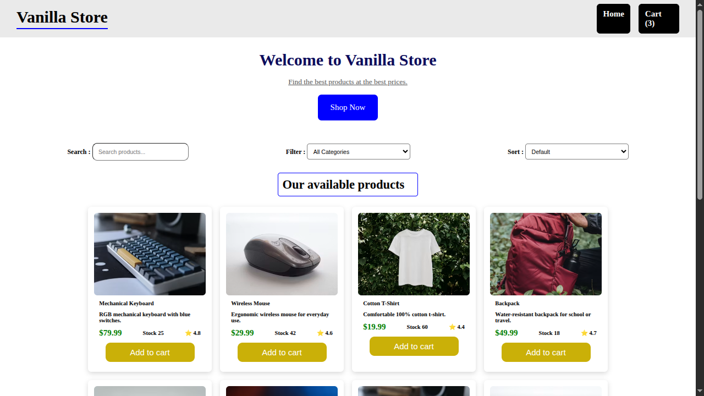
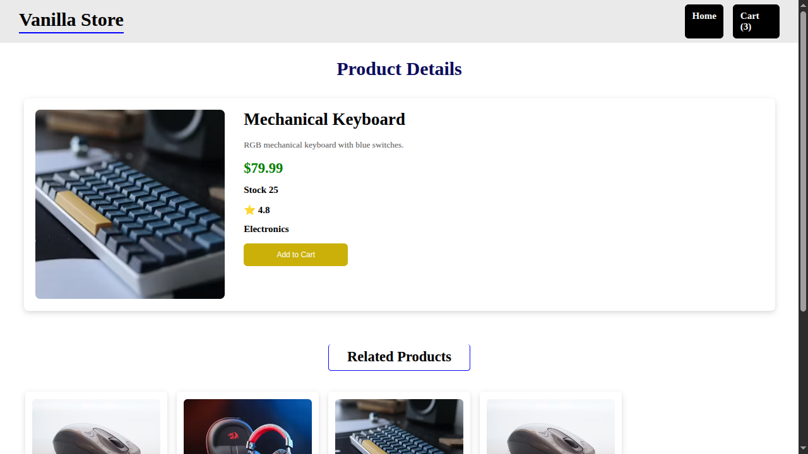
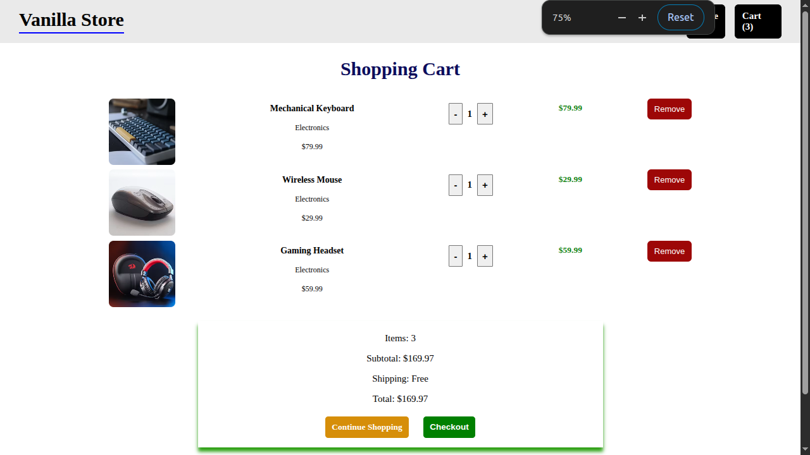

# Vanilla Store

A simple e-commerce website built with **HTML**, **CSS**, and **Vanilla JavaScript**.  
The project demonstrates fundamental frontend development concepts without using any frameworks.

## Features

- Browse products
- Search products by name
- Product details page
- Related products
- Shopping cart
- Add products to cart
- Remove products from cart
- Increase and decrease product quantity
- Cart summary (items, subtotal, total)
- LocalStorage persistence
- Checkout page
- Out-of-stock handling
- Responsive design

## Tech Stack

- HTML5
- CSS3
- JavaScript (ES6)
- LocalStorage API

## Folder Structure

```
.
├── assets/
│   └── images/
├── css/
│   └── style.css
├── data/
│   └── products.json
├── js/
│   ├── api.js
│   ├── app.js
│   ├── cart.js
│   ├── product.js
│   ├── storage.js
|   ├── success.js
│   └── ui.js
├── index.html
├── product.html
├── cart.html
├── success.html
└── README.md
```

## Pages

### Home

- Display all products
- Search products
- Add items to cart
- View cart count

### Product Details

- Product image
- Description
- Price
- Rating
- Category
- Stock status
- Related products
- Add to cart

### Cart

- View cart items
- Change quantity
- Remove items
- View subtotal
- Checkout

### Success

- Order confirmation
- Continue shopping

## Cart Storage

The shopping cart is stored in the browser using **LocalStorage**.

Example:

```json
[
  {
    "id": 3,
    "quantity": 2
  },
  {
    "id": 7,
    "quantity": 1
  }
]
```

## Installation

Clone the repository:

```bash
git clone https://github.com/yourusername/ecommerce-app.git
```

Open the project folder.

Run a local server (recommended):

Using VS Code Live Server:

```
Right Click -> Open with Live Server
```

or

```bash
python3 -m http.server
```

Then open:

```
http://localhost:8000
```

## Screenshots

```
screenshots/
    home.png
    product.png
    cart.png
    success.png
```





## Future Improvements

- Dark mode
- Pagination
- Wishlist
- User authentication
- Backend integration
- Payment gateway
- Order history

## What I Learned

During this project I practiced:

- DOM manipulation
- ES6 modules
- Event handling
- LocalStorage
- Dynamic UI rendering
- Responsive layouts
- Project organization
- Working with JSON data
- State management without frameworks

## License

This project is open source and available under the MIT License.